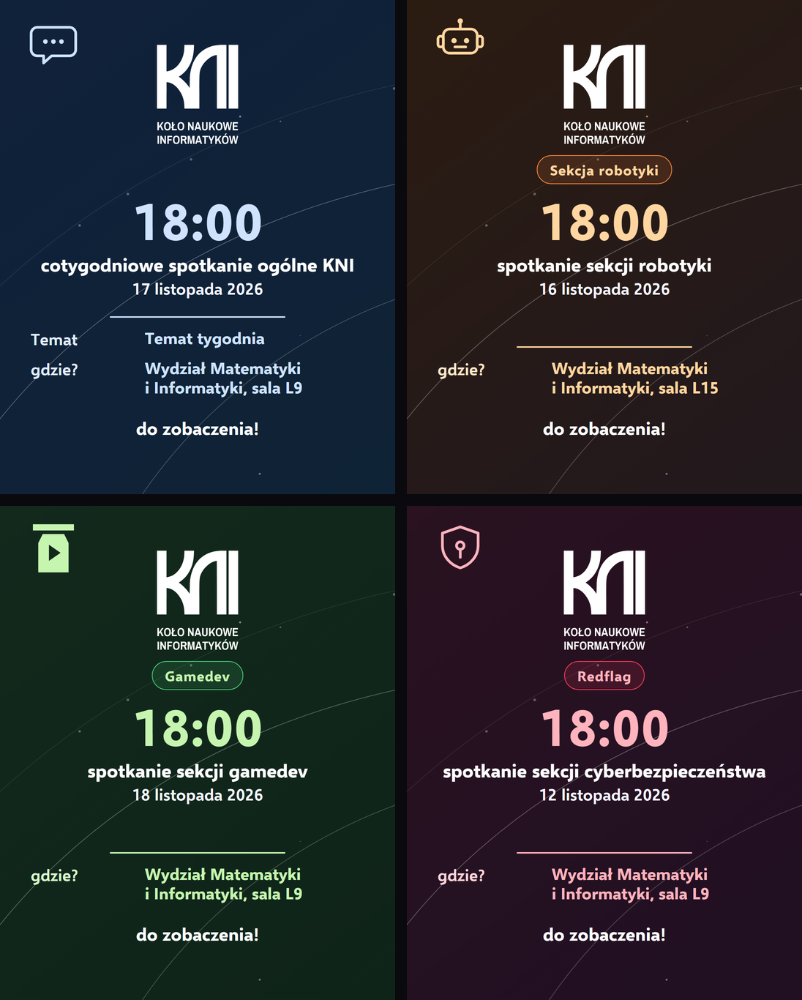
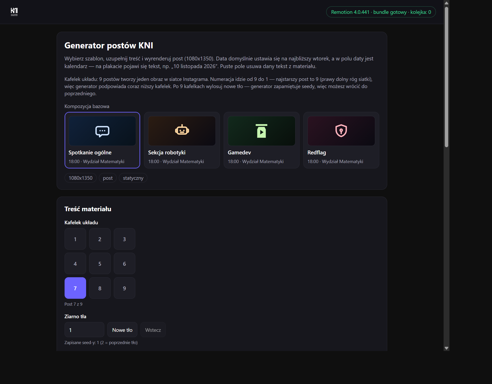

# KNI posters

Repo generuje statyczne posty na Instagram (1080x1350) w Remotion (React + TypeScript).
Materiał to jedna klatka PNG.



Szablony spotkań sekcji: spotkanie ogólne, sekcja robotyki, gamedev i Redflag.

## Wymagania

- Node.js LTS (npm)

## Instalacja

```bash
npm install
```

## Remotion

Uruchomienie podglądu (Studio):

```bash
npm run remotion:studio
```

Lista dostępnych kompozycji:

```bash
npm run remotion:compositions
```

Render domyślnego szablonu postu (`PostSpotkanieBase`) do PNG:

```bash
npm run remotion:still
```

### Render dowolnej kompozycji

Każda pozycja z `src/posts/registry.ts` jest kompozycją Remotion. Renderuj ją, podając jej `id`:

```bash
npx remotion still src/index.ts <ID> out/<nazwa>.png --frame=0
```

Przykład gotowego skryptu:

```bash
npm run remotion:still
```

Kompozycje postów mają `durationInFrames: 1`, więc każda klatka wygląda tak samo — `--frame` nie ma znaczenia.

## Struktura materiału

Każdy materiał to trzy części:

- komponent postu (wspólny `PostSpotkanieBaseTemplate`) i jego propsy,
- `src/posts/<temat>/<typ>-<temat>-<rrrr-mm-dd>.post.ts` — definicja kompozycji (`id`, `spec`, `defaultProps`, opcjonalnie `caption`),
- wpis w `src/posts/registry.ts` (`postRegistry`).

`src/Root.tsx` automatycznie mapuje `compositionRegistry` na `<Composition />` — nie dodawaj tam rekordów ręcznie.

Nowe posty rób na szablonie `PostSpotkanieBase`
(`src/posts/post-spotkanie-base/post-spotkanie-base-template.component.tsx`):
wystarczy nowa definicja z innym `id`, tekstami, `dateISO`, `shapeIndex` i `seed`. Daty nie wpisujemy
ręcznie — pole `dateISO` (`RRRR-MM-DD`) jest formatowane na tekst, np. `2026-10-03` -> `3 października 2026`.
`shapeIndex` (0-8) wybiera kafelek układu, a `seed` — które tło (ten sam seed = ten sam układ słoneczny).

## Opis (caption) do posta

Opis publikowany razem z postem trzymamy w polu `caption` w pliku `.post.ts`.
Dodatkowo wersję do wklejenia umieszczamy w pliku `<...>.opis.md` obok komponentu.
Dzięki temu kod i treść nie rozjeżdżają się.

## Zdjęcia (opcjonalne)

Nie każdy materiał musi mieć zdjęcia — prosty post tekstowy jest OK
(np. `PostSpotkanieBase`).

Materiały ze zdjęciami:

- zdjęcia wrzucamy do `assets/meetings/<rrrr-mm-dd>/` i importujemy w pliku `.post.ts`,
- `slides[].imageSrc` może być opcjonalne — brak wartości = czytelny placeholder, więc materiał renderuje się przed dodaniem zdjęć.

## Wspólna stylistyka postów

Każdy post o spotkaniu ma ten sam układ tekstu (logo, duża godzina, nagłówek, data,
temat, miejsce, stopka) i to samo, ciągłe tło rozpisane na mozaikę 3x3:

- `src/components/backgrounds/SolarSystemBackground.tsx` rysuje **jeden globalny obraz**:
  ciemny gradient, gwiazdy i proceduralny układ słoneczny (słońce + orbity + planety + pas
  planetoid). Post przesuwa tylko `viewBox`, więc na styku kafelków nie ma szwu ani przyciemnionych
  brzegów — wszystko liczone jest w jednych współrzędnych mozaiki.
- `src/core/mosaic/solarSystem.ts` buduje układ z `seed` (deterministyczny generator), a
  `src/core/mosaic/mosaic.ts` mapuje `shapeIndex` 0-8 na kolumnę i wiersz siatki.
- Geometria mozaiki odpowiada temu, co naprawdę widać na profilu: Instagram pokazuje posty 4:5
  w siatce 3:4 (przycina boki) i zostawia odstęp między kafelkami. Stałe `MOSAIC_GRID_ASPECT`,
  `MOSAIC_CROP_X`, `MOSAIC_GAP` oraz `MOSAIC_PITCH_X/Y` w `mosaic.ts` uwzględniają oba efekty,
  więc sąsiednie posty schodzą się w siatce co do piksela.
- Orbity są cienkie i przygaszone, a słońce nie ma jasnego rdzenia (na środku kafelka leży tekst),
  żeby wzór nie psuł czytelności.

### Ikona, kolorystyka i nagłówek sekcji

- `icon` — jednokolorowa ikona w lewym górnym rogu. Domyślny jest własny zestaw KNI
  (`src/core/icons/kni-icons.json`): `kni-robot` (robotyka), `kni-gamepad` (gamedev),
  `kni-chat` (spotkania ogólne), `kni-shield` (Redflag), `kni-shapes` (matematyka).
  Znaki sekcji w wersji wypełnianej siedzą w paczce `brand` (`src/core/icons/kni-brand-icons.json`) —
  `kni-gamedev` to słoik z dżemu z przyciskiem play (logo `assets/logoGamedev*.svg`).
  Do wyboru jest też cała paczka Phosphor w wariancie bold (`src/core/icons/phosphor-icons.json`,
  `npm run icons:build`). Rysuje je `src/components/icons/TopicIcon.tsx`.
- `theme` — paleta z `src/core/posts/post-themes.json` (czytana przez `postThemes.ts`):
  `default` (tematy), `general` (spotkania ogólne), `robotics` (bursztyn), `cyber` (Redflag, czerwień),
  `gamedev` (zieleń). Paleta zmienia też tło mozaiki. Ustawiasz ją w definicji kompozycji —
  w formularzu nie ma osobnego wyboru, bo kolor wynika z wybranego szablonu spotkania.
- `sectionLabel` — nagłówek sekcji pod logo (`Sekcja robotyki`, `Redflag`); puste pole ukrywa nagłówek.

Szablony spotkań sekcji:

- `PostSekcjaOgolna` — wtorki, 18:00, sala L9 (`src/posts/post-sekcja-ogolna/`),
- `PostSekcjaRobotyka` — poniedziałki, 18:00, sala L15 (`src/posts/post-sekcja-robotyka/`),
- `PostSekcjaGamedev` — środy, 18:00, sala L9 (`src/posts/post-sekcja-gamedev/`); godzina i sala do potwierdzenia,
- `PostRedflag` — czwartki, 18:00, sala L9 (`src/posts/post-redflag/`); godzina i sala do potwierdzenia.

W generatorze kompozycję wybierasz kafelkami (podgląd ikony, nazwa sekcji, godzina i sala),
`icon` to picker z wyszukiwarką (zestaw KNI + cała paczka Phosphor), a `sectionLabel` zwykłe pole
tekstowe. `PostSpotkanieBase` jest ukryty w generatorze — zostaje jako szablon techniczny.

## Czcionki

Czcionki są częścią repo (`public/fonts/`) i wczytuje je `src/core/fonts/kniFonts.ts`.
Dzięki temu render wygląda identycznie lokalnie i w kontenerze — minimalny obraz
Linux nie ma czcionek Segoe UI ani Trebuchet MS.

- `public/fonts/selawik-*.woff2` — Selawik (SIL OFL 1.1, licencja w `public/fonts/LICENSE.txt`),
  metrycznie zgodny z Segoe UI, więc układ i zawijanie tekstu nie zmieniają się.
- Komponenty ustawiają `fontFamily: KNI_FONT_FAMILY`; nazw czcionek systemowych nie wpisujemy.
- `delayRender` w `kniFonts.ts` wstrzymuje render, aż pliki się wczytają (brak cichego
  zejścia na czcionkę zapasową).
- Katalog `public/` jest kopiowany do obrazu w `Dockerfile` (`COPY public ./public`).

## Główne pliki Remotion

- `src/index.ts`
- `src/Root.tsx`
- `src/core/posts/InstagramPostDefinition.ts`
- `src/core/dates/plDate.ts`
- `src/core/fonts/kniFonts.ts`
- `src/core/posts/postThemes.ts`
- `src/core/posts/post-themes.json`
- `src/core/icons/icon-packs.json`
- `src/core/icons/kni-icons.json`
- `src/core/icons/kni-brand-icons.json`
- `src/core/icons/phosphor-icons.json`
- `src/components/icons/TopicIcon.tsx`
- `src/core/mosaic/mosaic.ts`
- `src/core/mosaic/solarSystem.ts`
- `src/components/backgrounds/SolarSystemBackground.tsx`
- `src/posts/post-spotkanie-base/post-spotkanie-base-template.component.tsx`
- `src/posts/post-spotkanie-base/post-spotkanie-base.post.ts`
- `src/posts/registry.ts`
- `remotion.config.ts`

## Web UI (generator postów)

`server/` to mini-aplikacja (Node, bez zależności poza Remotion) wystawiająca formularz:
wybierasz szablon postu, nadpisujesz teksty i renderujesz podgląd (PNG 0,4x) albo PNG
w pełnej rozdzielczości. Zadania lecą pojedynczo w kolejce, wyniki lądują w `out/`
(w kontenerze na wolumenie), historia w `out/jobs.json`, a ostatni kafelek układu i historia
seedów leżą w `out/ui-state.json`.



Pola formularza:

- **Kafelek układu** — siatka 3x3. 9 postów tworzy jeden obraz w siatce Instagrama; generator
  pamięta ostatnio wygenerowany kafelek (`out/ui-state.json`) i domyślnie podpowiada następny.
  Numer przesuwa się dopiero po **Renderuj PNG** — podgląd nie zużywa kafelka. Wybór i podpowiedź
  przechodzą też między kompozycjami bazowymi.
  Numeracja idzie od 9 do 1: najstarszy post to 9 i trafia w prawy dolny róg siatki, a kolejne
  posty (8, 7, ... 1) dokładają się przed nim — dlatego generator schodzi z kafelka 8 do 0.
- **Ziarno tła** — liczba, z której generator buduje układ słoneczny. Przycisk **Nowe tło**
  losuje nowy seed (po 9 kafelkach masz świeże tło), a **Wstecz** wraca do poprzedniego.
  Historia seedów jest zapisana w `out/ui-state.json`, więc działa też po restarcie.
- **Data spotkania** — kalendarz (`input[type=date]`). Domyślnie ustawia się najbliższy
  wtorek (dzisiaj, jeśli dzisiaj jest wtorek), a przyciski **Najbliższy wtorek**
  i **Najbliższy poniedziałek** ustawiają datę ponownie. Pod polem widać tekst,
  który pojawi się na plakacie, np. `10 listopada 2026`.
- reszta to teksty postu; puste pole usuwa dany tekst.

Uruchomienie lokalne:

```bash
npm install
npm run browser:ensure   # pobiera Chrome Headless Shell do node_modules/.remotion
npm run serve            # http://127.0.0.1:8083
```

Zmienne środowiskowe: `PORT` (domyślnie 8083), `HOST` (0.0.0.0), `OUT_DIR`
(domyślnie `./out`), `REMOTION_CONCURRENCY` (domyślnie auto = liczba rdzeni).

API: `GET /api/health`, `GET /api/compositions` (zwraca też `shapeIndexSuggestion` i stan seedów),
`GET|POST /api/seeds` (`roll` / `back` / `select`), `GET|POST /api/jobs`, `GET /api/jobs/<id>`,
`GET /api/jobs/<id>/log`, `GET /api/jobs/<id>/file`, `DELETE /api/jobs/<id>` (anuluj/usuń).

### Docker (opcjonalnie)

Repo ma `Dockerfile` (Node 22 + Chrome Headless Shell), więc generator uruchomisz też poza Windows:

```bash
docker build -t kni-posters .
docker run --rm -p 8083:8083 -v "$PWD/out:/app/out" kni-posters
```

Kontener nasłuchuje na porcie `8083` i nie potrzebuje zewnętrznych usług — wystaw go tak,
jak pasuje do Twojej infrastruktury (reverse proxy, VPN, sieć lokalna). Wzorcowy
`docker-compose.yml` jest w `deploy/docker-compose.example.yml`.

### Automatyczny deploy (GitHub Actions)

`.github/workflows/deploy.yml` po pushu na `main` uruchamia na serwerze skrypt wdrożeniowy
(`git fetch` + `docker build` + `docker compose up`). Wymagane sekrety w repo
(Settings -> Secrets and variables -> Actions):

- `DEPLOY_HOST` — adres serwera,
- `DEPLOY_USER` — użytkownik, który wykonuje deploy,
- `DEPLOY_SSH_KEY` — klucz prywatny SSH tego użytkownika,
- `TS_OAUTH_CLIENT_ID` / `TS_OAUTH_SECRET` — klient OAuth Tailscale z tagiem `tag:ci`
  (runner wchodzi do tailnetu, jeśli serwer nie jest osiągalny publicznie).

Skrypt `/srv/kni-posters/deploy.sh` leży na serwerze i nie jest częścią repo.
Brak sekretów = czerwony run, więc zielony run zawsze znaczy „wdrożono”.

## Licencja

Kod (Remotion, serwer, skrypty) jest na licencji MIT — patrz [LICENSE](LICENSE).
Możesz go kopiować, rozwijać i używać we własnych materiałach.

Znaki i assety KNI nie są objęte MIT: logo (`assets/logoKNI*.svg`, `assets/logoGamedev*.svg`),
ikony z `src/core/icons/`, zdjęcia (`assets/meetings/`, `assets/TFNiS2026/`) i gotowe
materiały zostają własnością Koła Naukowego Informatyków i można ich używać tylko
w materiałach KNI. Czcionka Selawik ma własną licencję (SIL OFL 1.1) w `public/fonts/LICENSE.txt`,
a paczka Phosphor jest na MIT (licencja w pakiecie `@phosphor-icons/core`).
